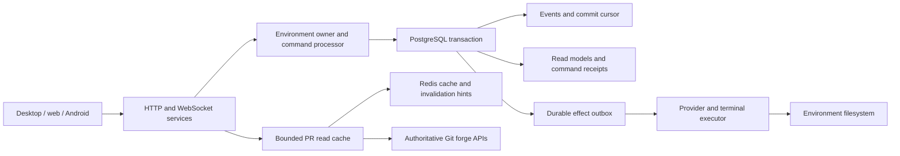

# Linux server storage boundary

The Linux standalone server uses PostgreSQL as the authority for durable application state and Redis as a disposable shared cache. Desktop local mode retains its embedded database. An explicitly configured PostgreSQL backend must never fall back to a local SQLite database after a connection failure.

## Authority and ownership

PostgreSQL owns events, projections, command deduplication, effect outbox rows, scheduled tasks, webhook deduplication, pairing and access records, provider session metadata, and review state. Redis has no unique copy of a command, credential, approval, or conversation. Losing or flushing Redis must not lose accepted work.

An environment still owns its provider subprocesses, PTYs, browser sessions, repositories and worktrees. A database pool does not make these resources transferable. The first deployment supports one active environment owner. Additional API instances require routing to that owner, fencing durable writes, and an explicit process-loss recovery policy before they can execute work.

Each environment gets its own PostgreSQL schema and a metadata record binding the schema to its persisted environment identity. A second unrelated data directory cannot silently share the schema. Pools set a fixed validated search path, UTC, connection and statement timeouts. Database and Redis URLs are redacted configuration, not client settings or log attributes.

## Commit order and effects

Existing clients advance a global event cursor. PostgreSQL sequences allocate numbers before commit, so ordinary identity columns cannot guarantee that cursor order matches commit order. Event-producing transactions must acquire the environment's write-order lock before deduplication, version checks and sequence allocation. The lock is held through commit. Reads use separate pooled connections and do not acquire this lock.

An event transaction commits the event, projection updates, command receipt, and effect-outbox entries together. External provider, filesystem and network work starts after commit. Only serialization failures and deadlocks may be retried before external work; a lost connection during COMMIT is an unknown outcome and must be resolved using the command receipt rather than replaying a paid provider turn.

Workers claim durable effects using PostgreSQL conditions, row locks and persisted ownership. The current implementation keeps the local wake queue and database scans; a future Redis wake hint must preserve those scans. Completion and retries remain in PostgreSQL. Process-bound effects retain the existing conservative recovery rules.

## Cache policy

| Data                                                                | Location               | Consistency and lifetime                                                        |
| ------------------------------------------------------------------- | ---------------------- | ------------------------------------------------------------------------------- |
| Event cursor, grants, command receipts and outbox                   | PostgreSQL             | Transactional; never served from a positive authorization cache                 |
| Thread shell/read-model snapshots                                   | Bounded L1             | Revision-keyed; publish or invalidate only after commit; always reconstructible |
| PR and external read results                                        | Bounded L1 and Redis   | Scope revision plus TTL; failed lookups are not cached                          |
| Provider catalogs and availability                                  | Bounded L1             | Keyed by provider instance and configuration generation; short TTL              |
| Parsed documents, search cursors, Git working-tree state            | Owner-local bounded L1 | Byte/count limits; tied to local content or filesystem generation               |
| PTYs, live sockets, provider subprocess handles                     | Owner process          | Never serialized into Redis                                                     |
| Attachments, artifacts, worktrees, logs and local encrypted secrets | Filesystem             | Explicit retention, protected paths and backup manifest                         |

Redis keys include environment identity, schema/cache version and a hashed scope. Cache payloads have a size limit, bounded TTL and jitter. Namespace clearing must use scoped key iteration, never FLUSHDB or FLUSHALL. Redis failure bypasses caching and reads the authority. PostgreSQL failure rejects durable mutations and protected operations; Redis must not hide it with stale state.

All cache state on the cache Redis instance is evictable. Correctness locks and durable queues must not share an eviction policy with it. Logical Redis database numbers do not provide memory or eviction isolation.

## Migration and rollback boundary

The source schema currently has 105 SQLite migration entries and SQLite-specific JSON, index-hint, FTS5, PRAGMA and ownership-lock behavior. PostgreSQL has native schema version metadata, explicit query-dialect adaptations, a GIN trigram search index and native maintenance. A build with a different SQLite migration head is rejected until its PostgreSQL baseline is updated. The SQLite migration chain runs only on an import's staging copy, and maintenance never targets the retained rollback database.

Cutover is offline: stop writes and provider execution, create a consistent SQLite snapshot, verify integrity and foreign keys, record checksums and table counts, copy filesystem/secret material into the backup set, and import into an empty target schema in a transaction. Verify row counts, key ranges, event ordering, projections and representative content hashes before changing the service configuration. Never reset a nonempty target schema as part of an import.

Before the PostgreSQL server accepts new writes, rollback uses the untouched SQLite snapshot and old service configuration. After PostgreSQL accepts new writes, rollback requires an explicit export/reconciliation step or a restore to the cutover point; simply selecting SQLite again would discard newer work. Backup restoration must be exercised independently of Redis.

## Operational checks

Validate actual PostgreSQL and Redis services, including concurrent event commits, duplicate commands, worker restarts, Redis flush/outage, PostgreSQL connection loss, a failed import, and backup restoration. Include a real orchestration turn using the replay provider and cross-client cursor resynchronization. A green SQLite test suite or a successful connection probe does not establish PostgreSQL compatibility.
